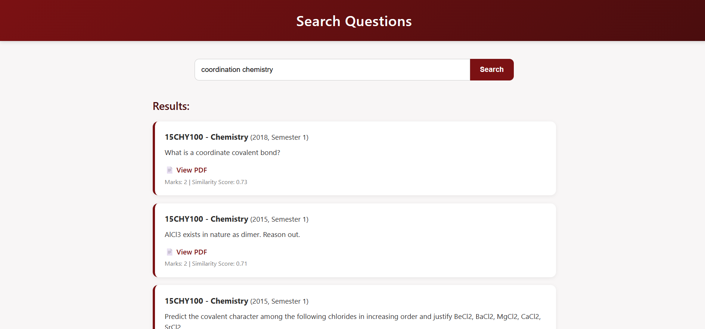
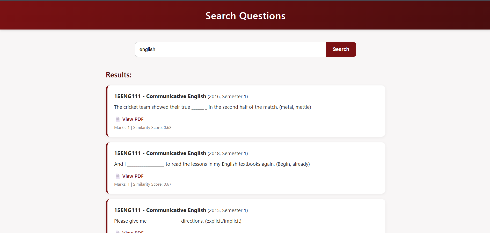
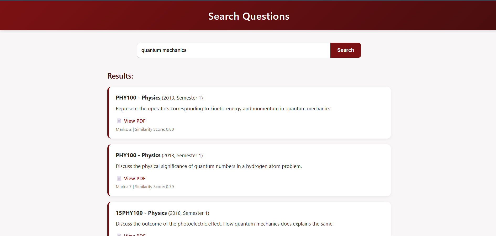

# EXAM RAG
 
[](https://www.python.org/) [](https://www.langchain.com/) [](https://qdrant.tech/)

---

### **Project Description** 

**Exam RAG** is an **AI-powered system** that automates finding, organizing, and searching past exam papers from the Institutional Repository. It's a two-stage process: first, it crawls a website to find and download PDF files into memory, then it uses an AI to extract and structure the questions from those PDFs. These structured questions are stored in a **Qdrant vector database** along with their **vector embeddings**, enabling **semantic search** with filters for course, year, semester, difficulty and marks.

---

### **Features** 

* **Web Crawler:** Finds and collects all PDF links from a specified repository (e.g., Amrita DSpace).
* **PDF Miner:** Extracts raw text from PDF documents on the fly.
* **AI Question Splitter:** Uses **LangChain** to convert raw text into a clean, structured JSON format, with each line representing a single question.
* **Modular:** The project is divided into separate scripts for crawling and processing for a clean workflow.
* **Semantic Search:** Allows for searching questions based on meaning and context, not just keywords, by leveraging vector embeddings from the database.
* **Filters & de-duplication:** Narrow results by course, year, semester, difficulty and marks; a question asked in several years shows up once with "Asked 3× (2012, 2014, 2016)".
* **Difficulty tags:** Rule-based easy / medium / difficult tags from marks and Bloom's-taxonomy task verbs.
* **Find papers by course:** Every B.Tech paper on DSpace (8,580 papers, 1,692 courses, 2010–2025) listed by course code/name, exam and year — read from each paper's header, so new papers show up before their questions are extracted.

---

### **Tech Stack & Dependencies** 

### **Core Libraries** 

-   **`qdrant-client`**: Vector database for questions, embeddings and filterable metadata.
-   **`json`**: For handling JSON data (`.jsonl` files).
-   **`os`**: For file and directory management.
-   **`numpy`**: For numerical operations on vector embeddings.

### **Web & PDF Processing** 

-   **`requests`**: For downloading web pages and PDFs.
-   **`pdfplumber`**: For extracting text and tables from PDF files.
-   **`io`**: For handling in-memory data streams.

### **AI & Semantic Search** 

-   **`langchain`**: To interact with the model.
-   **`sentence_transformers`**: For generating text embeddings.
-   **`BAAI/bge-base-en-v1.5`**: Embedding model (queries use BGE's retrieval instruction prefix).

### **Web Interface** 

-   **`flask`**: For building a simple web application to demonstrate the search functionality.
---

### **Running it (development)**

```bash
pip install -r requirements.txt
docker compose up -d qdrant                # Qdrant on :6333

python cleaning.py                         # dspace_questions_metadata.jsonl -> dspace_questions_clean.jsonl
python difficultyTagging.py                # -> dspace_questions_tagged.jsonl
python databaseCreate.py --rebuild         # embed + index into Qdrant
FLASK_DEBUG=1 python app.py                # http://localhost:5000
```

No Docker? Prefix the last two commands with `QDRANT_PATH=qdrant_local` to run Qdrant embedded in-process. On macOS, port 5000 is often taken by AirPlay Receiver; use `PORT=5050 python app.py`.

### **Deploying (production)**

```bash
docker compose up -d --build               # nginx :8080 -> app (gunicorn) -> Qdrant + Redis
python databaseCreate.py --rebuild         # first time only: index into the Qdrant container
# before exam season: more app replicas, then let nginx pick them up
docker compose up -d --scale app=3 && docker compose exec nginx nginx -s reload
```

- **nginx** (`deploy/nginx.conf`) balances across app replicas (`least_conn`), rate-limits `/search` per IP (generously — campus Wi-Fi shares IPs), caches `/papers` and `/facets`, and can cache DSpace PDFs (`PDF_BASE_URL=/dspace`, agree this with the library first).
- **app**: gunicorn, `WEB_CONCURRENCY` workers per container, `/healthz` for health checks, debug always off. Search results are cached in **Redis** for 6 h — the index only changes once a semester and exam-week queries repeat a lot.
- Never run `python app.py` (Flask's development server) on a reachable network.

### **Tests and evaluation**

```bash
python -m pytest                           # cleaning, sub-part splitting, header parsing, BM25
python search_eval.py score                # search quality on 28 judged queries (search_eval_qrels.json)
python evaluate.py                         # extraction model on hand-labelled sample_pdfs/
```

### **Pipeline**

| Step | Script | Output |
|---|---|---|
| Crawl DSpace for PDF links (all pages, keeps `processed` flags) | `scrapeLinks.py` | `pdf_links.jsonl` |
| Course/exam/year of every paper from its header | `catalog.py` | `papers_catalog.jsonl`, `pdf_cache/` |
| LLM question + metadata extraction | `processPDF.py` | `dspace_questions_metadata.jsonl` |
| Normalise semester/year/course code, strip numbering | `cleaning.py` | `dspace_questions_clean.jsonl` |
| Difficulty tagging | `difficultyTagging.py` | `dspace_questions_tagged.jsonl` |
| Embed + index | `databaseCreate.py` | Qdrant collection `questions` |
| Search UI | `app.py` | |

### **Fine-tuned extractor**

A LoRA fine-tune of Qwen2.5-3B-Instruct replaces the cloud LLM for extraction.

```bash
python fix_training_data.py                # data_v2/ -> data_v3/ (grounded targets, int semesters, valid.jsonl)
bash finetune.sh                           # MLX LoRA on Apple Silicon
python evaluate.py                         # score on hand-labelled sample_pdfs/
python evaluate.py --model mlx-community/Qwen2.5-3B-Instruct-4bit   # base model, for comparison
```

`build_data_for_qs.py` rebuilds the training set from scratch (needs access to the DSpace server).
`evaluate.py` reports metadata accuracy, question recall, and the share of extracted questions that are actually in the PDF (hallucination check), with held-out papers reported separately from papers seen in training.

### **Implementation** 
 
 

